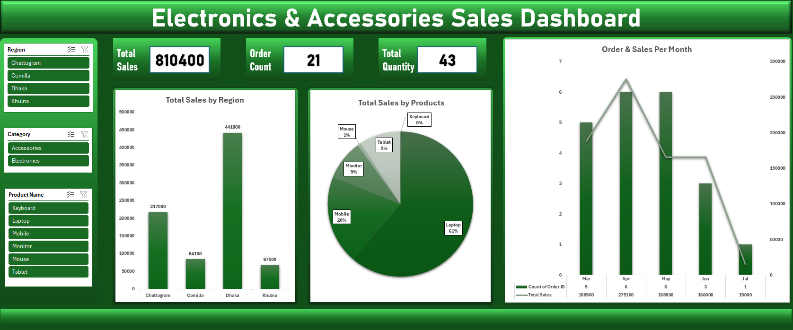

# Electronics & Accessories Sales Dashboard

> This repository contains a structured relational dataset and Excel dashboard focusing on electronics and accessories retail sales. The project explores relational data schema design, pivot tables, summary aggregations, and dashboard layouts to analyze customer purchasing behavior, top-selling categories, and regional sales performance. Marked as a practice project for data analysis, data modeling, and executive reporting.

## Questions answered
- How many total orders and sales revenue do we have? (21 orders; unit quantities and sales breakdown by product)

- Sales by product category and top-selling items (Electronics like Laptops & Mobiles vs Accessories like Mouse & Keyboards)

- Regional sales performance across Dhaka, Chattogram, Khulna, and Comilla regions

- Monthly sales trend and customer-wise purchasing patterns

- Quantity sold, order counts, and distinct order metrics per customer

## How it works
- Source data is structured in multiple Excel tables (Customers, Products, Sales); all analysis uses PivotTables.

- Summary cards and metrics stay dynamically linked to the pivot structures.

- Slicers and filters allow dynamic exploration of sales data by region and product category.

## Tools
Microsoft Excel: PivotTables, PivotCharts, slicers, data modeling, dashboard design.

## Files
- `electronics-accessories-sales-dashboard.xlsx` – the workbook

- `images/` – dashboard screenshots

## Author
Mohammed Faisal Fardin Chowdhury – B.Sc. in CSE, IIUC
